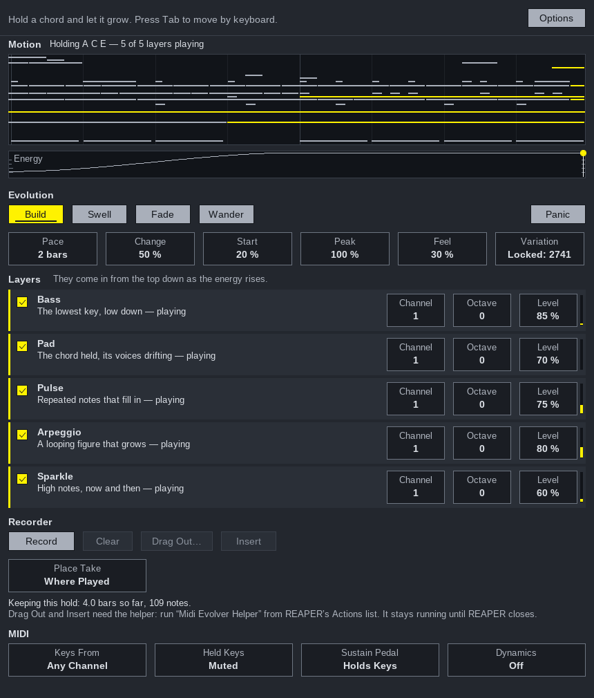

# Midi Evolver

**A REAPER JSFX that turns a held chord into music that moves.**

Hold some keys and the chord you hold grows: a bass comes in, then a held
pad whose inner voices drift, then repeated notes, a looping arpeggio and
high sparkling notes - one after another, evolving for as long as you hold
the keys. Let go and it stops. Hold again and it is a different variation.
It is the idea behind Spitfire's *Olafur Arnalds Cells* and Orchestral
Tools' *Time Macro* and *Time Micro*, done with MIDI only, so it plays
whatever instruments you already have.

Everything it plays is recorded. Drag the take into REAPER from the Media
Explorer, or insert it straight onto the track.



---

## Install

**With ReaPack** (recommended): *Extensions → ReaPack → Import repositories…*,
paste

```
https://raw.githubusercontent.com/KallumS/Midi-Evolver/main/index.xml
```

then *Extensions → ReaPack → Browse packages*, find **Midi Evolver** and
install it. That gives you the JSFX and the helper script together.

**By hand**: copy `Midi Evolver.jsfx` into REAPER's `Effects` folder, and the
three files in `reascripts/` into its `Scripts` folder (*Options → Show REAPER
resource path…*). In the Actions list, *New action… → Load ReaScript…* and
choose `Midi Evolver Helper.lua`.

## Set up

1. Put **Midi Evolver** on a track, **before** your instrument:

   ```
   [MIDI keyboard] → [Midi Evolver] → [piano / Kontakt / strings / synth …]
   ```

2. Record-arm the track and turn on input monitoring, so your keys reach it
   live.
3. Once per REAPER session, run **Midi Evolver Helper** from the Actions list.
   It has no window; it stays running in the background (its action shows as
   on) and is what lets Drag Out and Insert work. Running it again stops it.
   To have it start with REAPER, add it to your startup actions (SWS) or to
   `Scripts/__startup.lua`.

## Play

Hold a chord. The **Motion** view shows the last two bars of what is
playing - notes sounding now in yellow - and the **Energy** strip shows
where the hold is on its curve and where each layer comes in.

| | |
| --- | --- |
| **Shape** | **Build** starts quietly, grows over the pace, then keeps evolving at the top. **Swell** grows and falls back, again and again. **Fade** starts full and thins out. **Wander** rises and falls unpredictably. |
| **Pace** | How many bars the evolution takes. Fewer bars evolve faster - the layers come in sooner and the patterns change more often. |
| **Change** | How much the patterns themselves change as they go round. At 0% the arpeggio's figure stays as it began; at 100% it keeps turning, growing and shrinking. |
| **Start** / **Peak** | How much is going on the moment you press the keys, and how far it grows. A low Peak keeps the last layers out. |
| **Feel** | How far the timing and loudness wander, the way nobody plays a figure twice alike. |
| **Variation** | *New Each Time*, or *Locked* to the last one so you can play it again. The number is shown, so a variation you like can be found again. |

Change the chord while you hold and every layer follows it at once. The
sustain pedal (if *Sustain Pedal* is *Holds Keys*) keeps the chord evolving
after you let go, until the pedal comes up. While REAPER plays, everything
falls on REAPER's beats and bars; while it is stopped, on the moment you
pressed the keys.

### The layers

Each can be on or off, and has its own **Channel**, **Octave** and **Level**
- so the bass can go to the cellos, the pad to the strings, the arpeggio to
a harp or a piano, each on its own MIDI channel.

| Layer | What it plays |
| --- | --- |
| **Bass** | The lowest key, low down, struck once a bar, then on the half bar, then on every beat, with a fifth or an octave now and then. |
| **Pad** | The chord held, voiced wide at the bottom and close at the top; its inner voices step one at a time, and it adds voices as it grows. |
| **Pulse** | Repeated notes on a rhythm that fills in as the energy rises, its accents turning a step at a time. |
| **Arpeggio** | A looping figure of 5 to 7 notes against a bar of 4, so it drifts against the bar. It speeds up from eighths to triplets to sixteenths and opens out from one octave to three as it grows. |
| **Sparkle** | High, soft notes now and then, some echoed - only near the top. |

They come in from the top down as the energy rises; the first one that is
on always plays at once. Every note is one of the keys you hold, or now and
then a **colour tone** a whole tone above one (a 9th, 11th or 13th) that is
never a semitone from anything you hold - so over C E G you hear D and A,
never F or B.

### MIDI

| | |
| --- | --- |
| **Keys From** | Listen on any channel, or one. Keys on other channels pass straight through. |
| **Held Keys** | *Muted*: only Midi Evolver plays. *Played*: your own keys sound too. |
| **Sustain Pedal** | *Holds Keys* or *Ignored* (then the pedal is passed on to the instrument). |
| **Dynamics** | Also send the energy as CC1, CC11 or both - for sample libraries that swell with the mod wheel. |
| **Panic** | Stops every note Midi Evolver started. |

## Record and drag out

Without doing anything, **your last hold is kept** as the take. Click
**Record** to keep several holds in one take, with the pauses between, until
you click **Recording** to stop. A recorded take stays until you drag it
out, insert it, clear it or record again - a hold afterwards plays but does
not replace it.

- **Drag Out…** saves the take as a MIDI file and opens REAPER's **Media
  Explorer** with it selected. Drag it from there onto any track (or
  audition it there first). The files are kept in a *Midi Evolver* folder
  beside your project (in REAPER's own folder until the project is saved).
- **Insert** puts the take on Midi Evolver's own track as a new MIDI item -
  *Where Played* (if REAPER was playing when you held the keys) or *At Edit
  Cursor*, as **Place Take** says. One undo step.
- **Clear** throws the take away; **Undo** beside its message brings it back.

The take is saved with the project. Both buttons need the helper running;
the window says so if it isn't.

You can also let REAPER record Midi Evolver's output itself: set the track's
record mode to *Record: output (MIDI)* and record as usual.

## Interface

**Options → Interface Size** from 100% to 200%, remembered with the project.
Everything works from the keyboard: Tab and Shift+Tab move between controls
(a near-white ring shows where you are), Space or Return presses, the
arrows nudge a value (Shift for finer steps), Esc lets go. Messages appear at
the top and stay until you dismiss them.

The window follows Apple's Human Interface Guidelines as the rest of the
family does - see [docs/apple-hig-review.md](docs/apple-hig-review.md).

## Not yet tried in REAPER

Everything here has been checked by running the real JSFX in
[ysfx](https://github.com/JoepVanlier/ysfx) - the same EEL2 language and
drawing REAPER uses - with 275 checks of what it plays and how its window
behaves, and the helper script against a mocked REAPER (89 checks). **None
of it has been run inside REAPER yet.** The things only REAPER can confirm
are listed in [CLAUDE.md](CLAUDE.md) under *Unverified in REAPER*.

## For developers

```sh
tools/build_host.sh          # once: the headless host (needs cmake, g++, freetype, fontconfig)
tools/test.sh                # every suite
python3 tools/demo.py        # a hold printed bar by bar as note names
```

[CLAUDE.md](CLAUDE.md) is the working guide, [docs/decisions](docs/decisions/README.md)
the reasons, [docs/sessions](docs/sessions/README.md) what happened when.

## Credits

Built in the shape of KallumS's AutoCC (the JSFX window, its checker and the
house scheme), with ideas from Midi Variator (the clash guard, the dice, the
feel), Good Idea (a variation is a number; the .mid writer, by way of Midi
Catalogue and Starting Blocks; the export folder), ScaleView and Starting
Blocks. The music follows Alan Belkin's orchestration (planes, crescendo by
adding instruments), *Orchestration Analysis* (register, doubling in time),
Open Music Theory (unaccented neighbours) and Hutchinson's chapter on
minimalism (Reich's phasing, Glass's additive process).
